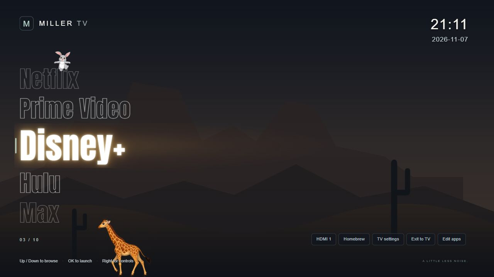
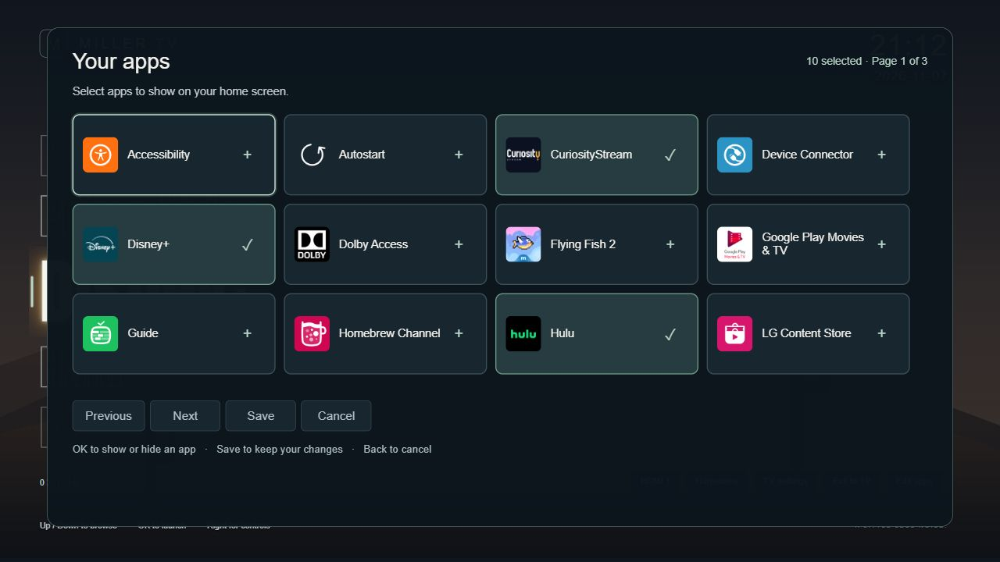

# Miller TV

A minimal LG webOS app carousel with editable app selections, a 24-hour clock,
ISO date, warm selection lighting, and animated bunny and giraffe companions.
Optional local startup video can play behind the Miller logo.

## Screenshots

Browser previews of the public source using the included generic desert
background. No personal photo, device connection or private media was used.
TV appearance and installed apps can differ.





## Requirements

- A rooted LG webOS TV with [Homebrew Channel](https://github.com/webosbrew/webos-homebrew-channel),
  root status OK, and working root SSH access. This project does not root a TV;
  check the [webOS Homebrew guide](https://www.webosbrew.org/rooting/) first.
- Git, Node.js 22 or newer, `tar`, and OpenSSH (`ssh` and `scp`) on your computer.
  Commands below use PowerShell from the repository directory. There are no npm
  dependencies to install.
- Your own authorized TV SSH key and an independently verified host-key record.
  Do not disable host-key checking or publish the key.

The validated target is an older OLED B7 running webOS 3.x. Other generations
need their own compatibility checks. Developer Mode alone does not provide the
root services used for app discovery, Home remapping or persistent startup.
A browser preview does not establish compatibility with a TV's older engine.

## 1. Clone, build and preview

```powershell
git clone https://github.com/miller-coffee/lg-webos-miller.git
cd lg-webos-miller
npm test
npm run build
npm run preview
```

Open <http://127.0.0.1:8787/>. Ctrl+C stops the localhost-only preview server.
Launching TV apps is unavailable in a desktop browser. The generated IPK is in
`dist/`, using the version declared in `app/appinfo.json`.

| Control | Action |
| --- | --- |
| Up / Down or scroll wheel | Browse apps |
| OK / Enter | Launch the selected app |
| Right | Move to utility controls |
| Left from the first utility control | Return to the carousel |
| Edit apps | Choose which installed apps appear |
| Save / Cancel | Apply / discard picker changes |

The picker only changes launcher visibility; it never uninstalls apps. Choices
and the last launched app are remembered locally. The bunny follows an active
pointer and returns to the app names when pointer use ends.

## 2. Configure your connection

```powershell
Copy-Item tv/device.example.json tv/device.json
New-Item -ItemType Directory -Force .local | Out-Null
```

Edit `tv/device.json`: replace `tv.example` with **your** TV's local hostname or
address; keep `user` as `root`. The real configuration is ignored by Git.

Put your already-authorized private SSH key at `.local/tv_owner_ed25519` and its
verified host-key record at `.local/known_hosts`. Use the Homebrew SSH setup for
initial key provisioning. If your key has a passphrase, load it into your SSH
agent first: these helpers use batch mode.

```powershell
./tools/tv.ps1 -RemoteCommand 'id; uptime'
```

Continue only when this reaches the intended TV and `id` reports root. If a host
key changes, verify device identity before updating the pin.

## 3. Install and launch

In PowerShell, prepare a connection and copy the built package:

```powershell
$tvDevice = Get-Content tv/device.json -Raw | ConvertFrom-Json
$tvTarget = $tvDevice.user + '@' + $tvDevice.host
$sshArgs = @('-i', '.local/tv_owner_ed25519',
    '-o', 'UserKnownHostsFile=.local/known_hosts',
    '-o', 'StrictHostKeyChecking=yes', '-o', 'BatchMode=yes')
$appInfo = Get-Content app/appinfo.json -Raw | ConvertFrom-Json
$ipk = 'dist/' + $appInfo.id + '_' + $appInfo.version + '_all.ipk'
scp -O @sshArgs $ipk "${tvTarget}:/tmp/miller-launcher.ipk"
ssh @sshArgs $tvTarget
```

`-O` selects the legacy SCP protocol supported by older TVs. The last command
opens a shell **on the TV**. Run this there:

```sh
luna-send -i -w 10000 luna://com.webos.appInstallService/dev/install '{"id":"org.miller.launcher","ipkUrl":"/tmp/miller-launcher.ipk","subscribe":true}'
```

Wait for an update containing `"state":"installed"`; an initial accepted/queued
response is not completion. Resolve any installer error before proceeding.
Then launch the app and leave the TV shell:

```sh
luna-send -n 1 luna://com.webos.applicationManager/launch '{"id":"org.miller.launcher"}'
exit
```

Open **Edit apps** on the TV, choose installed applications, and save. The bundled
catalog is a fallback, not a promise that every listed app exists on your TV.
To update, rebuild and repeat this install step.

Installing the IPK alone does **not** change startup or the physical Home button.
For those features, follow [the optional startup and Home setup](docs/startup.md)
after the manual launcher works. That guide includes prerequisites, backups,
hook installation, testing and recovery.

## 4. Optional background and movie

Add these locally **before** building, then rebuild and reinstall:

| Local file | Purpose |
| --- | --- |
| `app/assets/background.local.png` | Personal background layered above the generic desert |
| `app/assets/intro/startup.mp4` | H.264 video with AAC audio for the startup movie |

The movie appears behind the M logo. Normal remote buttons skip it; volume and
mute retain volume control. Preview your own movie at
<http://127.0.0.1:8787/?intro=1> (browser-preview audio is muted).
With no movie supplied, use the normal launcher preview.

These files, local manifests, screenshots outside `docs/images/`, and generated
packages are ignored by Git. Customized IPKs contain your media: do not upload
them as public release assets.

## Troubleshooting and development

| Symptom | Check |
| --- | --- |
| Browser cannot launch apps | Expected; launching requires the TV |
| SSH fails | TV awake, SSH enabled, local host, authorized key, agent and verified pin |
| Install fails | Build output exists, SCP completed, installer output explains the failure |
| Stuck on the M logo | Compile scripts in the real TV engine; modern browsers can miss legacy syntax errors |
| Home opens LG's ribbon | Compatible Input Hook, injected library, key code and merged mapping; see [startup setup](docs/startup.md) |
| Starts only after opening Homebrew | Homebrew native boot registration / legacy ActivityManager fix |
| Movie absent | Local MP4 included before build, updated IPK installed, optional intro hook installed |

Keep direct LAN debugger access blocked. `tv/00-miller-debug` restricts IPv4 TCP
9998 to loopback; check IPv6 separately if the firmware binds it there.
Use the authenticated localhost SSH tunnel for development and always close it:

```powershell
./tools/tv-debug.ps1 -Action Enable
try {
    $env:MILLER_TV_DEBUG_ENDPOINT = 'http://127.0.0.1:19998'
    node tools/check-tv.mjs --carousel --interactions --editor
} finally {
    ./tools/tv-debug.ps1 -Action Disable
}
```

The TV check compiles scripts in the actual legacy engine and exercises the UI.
`npm test` checks navigation, app editing, intro behavior, companions and package
contents. A clean checkout skips the private-video byte check because no movie
is distributed. No firmware or kernel image is included.

## Privacy and credits

`npm run audit:public` checks tracked files and reachable Git history for common
credentials, device identifiers, private files and image metadata. The README
screenshots use public assets only. Keep `tv/device.json`, `.local/`, personal
media, diagnostic logs and customized packages out of public commits. Loopback
addresses in tools are generic endpoints, not device identifiers.

Anton includes its SIL Open Font License at `app/assets/fonts/OFL.txt`.
App icons and third-party components retain their respective ownership.
